<div align="center">

# Oreo Doodle Icons ✏️

**197 hand-drawn icons that never sit still.**

Every stroke draws itself in, then keeps boiling like a Saturday-morning cartoon.

[**Play with them →** doodle.oreoui.com](https://doodle.oreoui.com)



</div>

## Install

```bash
npm i @oreo-design/doodle-icons
```

Or skip the package entirely and grab the SVGs — [`icons/`](icons) for still
ones, [`icons-animated/`](icons-animated) for ones that draw themselves and
wiggle forever. They are plain files. They work anywhere an SVG works.

## Use

```jsx
import { DoodleIcon, BoilFilter } from '@oreo-design/doodle-icons'

export default function App() {
  return (
    <>
      {/* mount once, anywhere — every icon on the page shares it */}
      <BoilFilter id="boil" />

      {/* wiggles forever */}
      <DoodleIcon name="heart" boilId="boil" size={32} />

      {/* draws itself on, then wiggles forever */}
      <DoodleIcon name="star" boilId="boil" draw size={32} />

      {/* put the same filter on Schoolbell headings — they wiggle too */}
      <h1 style={{ filter: 'url(#boil)' }} className="font-doodle">Paper Moon</h1>
    </>
  )
}
```

Both are props rather than defaults — the package cannot tell an icon apart
from a control. On a page built with this set, **pass `boilId` on every
icon**, and put the same filter on your Schoolbell headings; handwriting that
sits still next to boiling icons looks half-done. Keep `draw` for things that
mount once, like a hero, since it replays on every remount.

Strokes are `currentColor`, so colour comes from CSS like any other text:

```jsx
<span style={{ color: 'rebeccapurple' }}>
  <DoodleIcon name="bulb" boilId="boil" />
</span>
```

### Props

| Prop | Default | |
| --- | --- | --- |
| `name` | — | icon name, e.g. `"heart"` |
| `icon` | — | pass icon data directly instead of `name` |
| `size` | `24` | px, both axes |
| `strokeWidth` | `3.4` | the set is drawn for a chunky stroke |
| `boilId` | — | id of a mounted `<BoilFilter>`; pass it on every icon |
| `draw` | `false` | draw the strokes on, one after another, on first render |
| `drawDuration` | `0.32` | seconds per stroke |
| `drawDelay` | `0` | seconds before the first stroke starts — stagger a row with it |

Anything else is forwarded to the `<svg>`.

### `<BoilFilter>`

| Prop | Default | |
| --- | --- | --- |
| `id` | `"doodle-boil"` | referenced by `boilId` |
| `amplitude` | `4` | how far the ink wanders, in viewBox units. `1` is a shiver, `8` is a mess |
| `duration` | `"0.86s"` | one full cycle — lower is more frantic |
| `frequency` | `0.055` | grain of the noise; higher is a finer, more jittery hand |
| `frames` | `6` | how many hand-drawn frames the loop pretends to have |

The defaults are the values [doodle.oreoui.com](https://doodle.oreoui.com)
runs at, so what you install feels like what you played with. They are also
exported as `BOIL` if you want to build on them.

One filter serves the whole page — 200 boiling icons cost about what one does.

Mount it more than once for more than one intensity:

```jsx
<BoilFilter id="boil" />
<BoilFilter id="boil-loud" amplitude={8} duration="0.3s" />

<DoodleIcon name="flame" boilId="boil-loud" />
```

`<BoilFilter>` also registers the keyframes `draw` needs. If you want the
entrance without the wiggle, mount `<DoodleStyles />` on its own instead.

## The boil

The wiggle is not a video and not a sprite sheet. It is one SVG filter:
`feTurbulence` generates noise, `feDisplacementMap` pushes the ink around by
it, and a six-frame `<animate>` steps the noise seed on a loop.

Six discrete steps, not a smooth tween — the ink should *jump* between
drawings the way hand-inked animation does, rather than slide. Animators call
this a **boiling line**: hand-redrawn frames never land in quite the same
place, so the outline simmers even when nothing is moving.

Because the filter works on rasterized pixels, it costs the same whether the
icon has one path or twenty.

## Without React

Every icon is also a file:

```html

```

One catch: an SVG loaded through `` is its own little document, so
`currentColor` cannot reach it from your page — the still icons render black.
Inline the SVG (or use the React component) if you need to recolour it.

The data is exported too, if you would rather render it yourself:

```js
import { ICONS, getIcon, ICON_NAMES, COLLECTIONS } from '@oreo-design/doodle-icons'

getIcon('heart')  // { name: 'heart', paths: ['M 24 39 C …'] }
```

## What's here

- **197 icons**, stroke-only, in a 48×48 grid, drawn with a deliberately
  shaky hand. A new batch lands roughly every week
- **Two SVG builds** — still, and one that draws itself in and boils forever
- **React components** with tree-shaking, ESM + CJS + types
- **Zero runtime dependencies**. React is an optional peer

Icons are grouped into shelves — objects, communication, weather & nature,
media, interface, files, text, arrows, plus Halloween, Christmas, birthday,
love and stars — see `COLLECTIONS`.

### Themed sets

The newer icons come in small seasonal and themed sets, each with its own page
on the site:
[Halloween](https://doodle.oreoui.com/halloween-icons) ·
[Christmas](https://doodle.oreoui.com/christmas-icons) ·
[birthday](https://doodle.oreoui.com/birthday-icons) ·
[hearts](https://doodle.oreoui.com/heart-icons) ·
[stars](https://doodle.oreoui.com/star-icons) ·
[flowers](https://doodle.oreoui.com/flower-icons)

## Using with an AI coding agent

The repo ships a skill at [`skills/doodle-icons/SKILL.md`](skills/doodle-icons/SKILL.md)
that teaches an agent the one-time setup, every icon name, and the house
rules — Schoolbell pairing, paper-and-ink palette, the fact that every icon
and every hand-drawn heading wiggles while controls hold still, and how to
draw a control by hand instead of reaching for a stock one. Install it into
whichever agents you use:

```bash
npx skills add oreo-design/doodle-icons
```

That works for Claude Code, Cursor, Codex, OpenCode and most others. In
Claude Code you can also install it as a plugin:

```text
/plugin marketplace add oreo-design/doodle-icons
/plugin install doodle-icons@oreo-design
```

Or, since the skill is inside the npm package, just copy it:

```bash
cp -r node_modules/@oreo-design/doodle-icons/skills/doodle-icons .claude/skills/
```

Then ask for "hand-drawn icons" and it will do the right thing.

## Pro

A larger set by the same hand — 1,700+ more icons — is Pro. It lives at
[doodle.oreoui.com](https://doodle.oreoui.com) — everything in *this* repo
stays free and MIT forever.

## A note on the typeface

The site pairs these icons with
[Schoolbell](https://fonts.google.com/specimen/Schoolbell) by Font Diner,
which is not mine and is not included here. It is free under the SIL Open
Font License — grab it from Google Fonts.

## License

[MIT](LICENSE) — take the icons, take the wiggle, make something wobbly.

Built by [Nicole Tang](https://x.com/oreo_design) · part of
[Oreo UI](https://oreoui.com)
